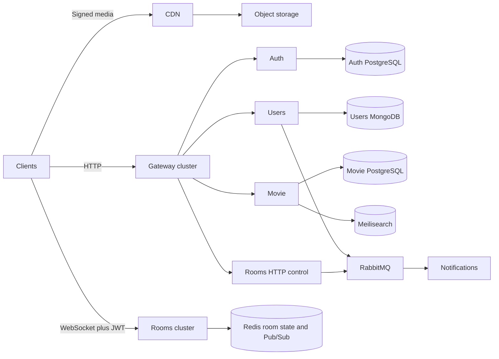

# Architecture map

## Ingress

Three public paths are required by ADR-001.

The Gateway is not on the WebSocket path and does not carry video bytes. That split is the main scaling decision in the pack.

## Service boundaries

| Service          | Owns                                                                                         | Does not own                              | Store                                  |
| ---------------- | -------------------------------------------------------------------------------------------- | ----------------------------------------- | -------------------------------------- |
| Auth             | Identity, password hash, refresh sessions, registration saga                                 | Profile, friends, movies                  | PostgreSQL                             |
| Users            | Profile, preferences, friendships, friendship outbox                                         | Credentials, room state                   | MongoDB                                |
| Movie            | Metadata, publication, media keys, watchlist if the ownership decision stands, search repair | Video bytes, room playback                | PostgreSQL plus Meilisearch projection |
| Rooms            | Room lifecycle, membership, permissions, playback sync, ephemeral chat and reactions         | Movie bytes, user profiles                | Redis for live state                   |
| Notifications    | Delivery, retry, dedup, in-app rows                                                          | The business action that caused the event | Proposed PostgreSQL, not Rooms Redis   |
| Transcode worker | HLS renditions                                                                               | Catalog rules                             | Reads and writes object storage        |
| Gateway          | Routing, JWT, rate limit, request context                                                    | Saga state and business events            | None                                   |
| Web              | Screens and the browser player                                                               | Authoritative state                       | None                                   |

Cross-service references use immutable ids. There are no distributed foreign keys.

## Consistency

| Flow          | Guarantee                                              | Mechanism                                             |
| ------------- | ------------------------------------------------------ | ----------------------------------------------------- |
| Registration  | No success until Auth is ACTIVE and the profile exists | Saga in Auth, idempotent profile create, compensation |
| Movie search  | Eventual                                               | PostgreSQL first, upsert, reconciliation              |
| Playback      | Last processed state may win                           | Redis sync point, optional monotonic version          |
| Notifications | At-least-once                                          | Manual ACK, two retries, DLQ, event id dedup          |
| Chat          | Ephemeral, idempotent visible retry                    | Redis TTL and client message id                       |
| Media         | Durable objects                                        | Direct multipart upload, queue, workers               |

## Unresolved boundary questions

These are decision tickets, not silent assumptions:

- Where a durable `ROOM_INVITED` outbox lives if Rooms has no database. ADR-005 and ADR-019 conflict.
- Whether publication status and media status share one column.
- Whether scheduled watches live in Movie PostgreSQL, which the plan proposes and ADR-005 did not.
- Whether published movie reads are anonymous.
- How an invite URL authorizes a private room.
- How the first admin scope is granted.

## Explicit non-architecture

Do not add Kubernetes, a service mesh, Kafka, a graph database, a Chat Service, a Streaming Service, DRM, or multi-CDN as part of v1. The decision log and the implementation plan both reject them. Redis HA and database failover are required in production, but Sentinel versus Cluster and the cloud vendor are still deferred.
