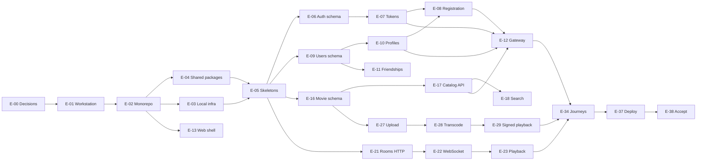

# Dependencies and implementation order

There are 626 blocking edges among 308 tickets. The generator rejected cycles. Ticket ids in `tickets.csv` are space-separated prerequisites.

## What must exist first

1. E-00 decision entries that the later ticket cites. A proposed default is written on the decision ticket. Do not treat that default as accepted until the entry exists.
2. Workstation, workspace, and local Compose.
3. Shared config, errors, logger, and JWT verification.
4. Service processes with health endpoints.
5. Auth and Users schemas before the registration saga.
6. Gateway JWT cache before protected clients.
7. Movie schema and Meilisearch before publish.
8. Redis room state before WebSocket join, and join before playback fan-out.
9. Upload authorization before transcode, and a ready master playlist before signed playback.
10. RabbitMQ topology before outbox publishers and the notification consumer.

## Parallel tracks after skeletons

These tracks share only the foundation:

- Auth tokens and the registration saga, once Users can create a profile.
- Movie catalog, search, and watchlist.
- Rooms HTTP, sockets, playback, and chat.
- Web shell, which can start from the workspace before every API exists. Screens still wait on their APIs.
- Observability scrape config can start once `/metrics` exists. Domain dashboards wait on domain metrics.

Media upload waits on the movie row. The room player can be built against playback events before signed HLS exists, then wired to the signed URL.

## Critical path

The longest effort path through the ticket dependency graph is 85 hours across 34 tickets. That number is the lower bound only when every chain that is not on this path has someone else working it. One engineer still has the full 775 hours of ticket effort. A team shortens calendar time toward that lower bound only for work the graph marks as parallel: Auth, Users, Movie, and Rooms after the skeletons exist.

1. T-0001 Accept the v1 stack, repository layout, and port map (2h, depends on nothing)
2. T-0026 Install and verify Node.js 20 LTS (1h, depends on T-0001)
3. T-0027 Install and verify pnpm (1h, depends on T-0026)
4. T-0031 Create the root package manifest and workspace scripts (2h, depends on T-0027, T-0030)
5. T-0032 Declare the pnpm workspace globs (1h, depends on T-0031)
6. T-0037 Create the Compose project and private network (2h, depends on T-0028, T-0032)
7. T-0044 Add MinIO and create the kinvue-media bucket (3h, depends on T-0037, T-0017)
8. T-0046 Publish the local environment example and port map (2h, depends on T-0038, T-0039, T-0040, T-0041, T-0042, T-0043, T-0044)
9. T-0048 Create the shared config package with Zod validation (3h, depends on T-0034, T-0032, T-0046)
10. T-0058 Boot the auth service process (2h, depends on T-0048, T-0049, T-0033)
11. T-0077 Add Auth PostgreSQL migration tooling (2h, depends on T-0058, T-0038)
12. T-0138 Add Movie PostgreSQL migration tooling (2h, depends on T-0064, T-0039, T-0077)
13. T-0139 Create the movies table from the accepted state model (3h, depends on T-0138, T-0013)
14. T-0143 Implement movie repository reads and writes (3h, depends on T-0139, T-0142)
15. T-0144 Implement admin movie creation as a draft (2h, depends on T-0143, T-0052)
16. T-0202 Authorize a direct multipart upload after metadata exists (4h, depends on T-0201, T-0140, T-0144)
17. T-0203 Complete the multipart upload and enqueue transcoding (3h, depends on T-0202, T-0042)
18. T-0207 Declare the media.transcode queue and job contract (2h, depends on T-0203, T-0074)
19. T-0208 Generate the HLS ladder and write it back to object storage (4h, depends on T-0207, T-0075, T-0017)
20. T-0209 Mark a movie READY only after the HLS master exists (3h, depends on T-0208, T-0139)
21. T-0212 Return a short-lived signed HLS URL (3h, depends on T-0209, T-0017, T-0201)
22. T-0119 Proxy watchlist, room control, and media-access routes (3h, depends on T-0115, T-0157, T-0166, T-0168, T-0172, T-0212)
23. T-0186 Start a solo watch or create a private or public room (3h, depends on T-0163, T-0166, T-0119)
24. T-0252 E2E create a private room (3h, depends on T-0186, T-0248)
25. T-0253 E2E invited friend joins a private room (3h, depends on T-0188, T-0252, T-0247)
26. T-0255 E2E grant controller permission (3h, depends on T-0189, T-0253)
27. T-0256 E2E synchronized play, pause, and seek (3h, depends on T-0190, T-0255)
28. T-0258 E2E room chat (3h, depends on T-0191, T-0256)
29. T-0259 E2E room reaction (3h, depends on T-0191, T-0258)
30. T-0263 Run the full local end-to-end journey suite (2h, depends on T-0243, T-0244, T-0245, T-0246, T-0247, T-0248, T-0249, T-0250, T-0251, T-0252, T-0253, T-0254, T-0255, T-0256, T-0257, T-0258, T-0259, T-0260, T-0261, T-0262)
31. T-0305 Run the automated acceptance commands (2h, depends on T-0242, T-0263, T-0281)
32. T-0306 Walk the product acceptance checklist (4h, depends on T-0305, T-0262, T-0261, T-0219, T-0237)
33. T-0307 Check metrics, dashboards, request ids, secrets, and CI (2h, depends on T-0306, T-0231, T-0238, T-0295)
34. T-0308 Tag the MVP release after acceptance passes (1h, depends on T-0307, T-0304, T-0302)

## Epic-level order

Notifications, scheduling, security regression, and CI integration are required for the MVP definition of done and are not all drawn on this reduced graph. Their ticket dependencies are still in the CSV.

## Integration points that need coordination

- Auth registration calls Users `POST /internal/users/profiles`. The contract package owns the body.
- Gateway header names `x-request-id`, `x-user-id`, and `x-user-scopes` are the only identity context downstream services should trust.
- Users and Rooms publish `FRIEND_REQUEST_CREATED`, `FRIEND_REQUEST_ACCEPTED`, and `ROOM_INVITED`. Notifications consumes those names.
- Movie complete-upload publishes `media.transcode`. The worker calls internal movie callbacks.
- The web client calls only the Gateway for HTTP and the Rooms socket for realtime.

## Services that can be developed independently

After the shared packages and Compose are up, Auth, Users, Movie, and Rooms can be implemented by different people. The saga is the first hard join between Auth and Users. The Gateway route table is the join between the client and every HTTP API. Playback fan-out does not need Movie to be finished. Signed playback does.
