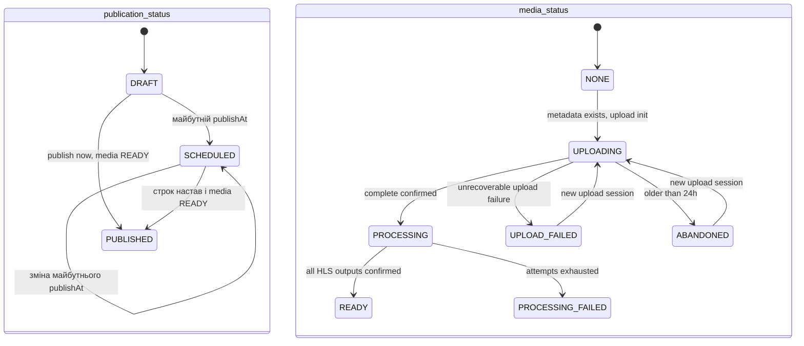

# 0026. Політики першого спринту Users і Movie

- Статус: прийнято
- Дата: 2026-11-01
- Джерело: чат 2026-11-01, явне погодження користувача всього пакета; KIN-40, KIN-44, KIN-48, KIN-67, KIN-75, KIN-81, KIN-87
- Замінено: немає

## Контекст

Користувач явно погодив увесь підготовлений пакет. G-06/C-02 і C-08 закриті цим рішенням; параметри нижче стають вимогами для наступних продуктових задач. Каркаси сервісів від цих політик не залежать.

## Username — KIN-40

Уже прийняте [0024](0024-registration-username-policy.md) має перевагу над прикладом із крапкою в Jira: trim, lowercase, ASCII `a-z`, `0-9`, `_`, 3–30 символів. Крапка заборонена. Унікальність нормалізованого username забезпечує Users. У v1 username не змінюється; PATCH профілю змінює лише поля, названі в KIN-343. Пароль і правила displayName з 0024 не змінюються.

## Пошук користувачів і пагінація — KIN-44

Прийнято: MongoDB, пошук за `username` та `displayName`, case-insensitive regex із екрануванням усіх regex-метасимволів у запиті. Запит є буквальним текстом, не довільним regex клієнта. Після trim потрібно щонайменше 2 символи; коротший запит повертає 400. Курсорна пагінація пошуку, вхідних/вихідних запитів і списку друзів має стабільний порядок `(createdAt, _id)` та містить обидва значення в наступному курсорі. Графова база, обходи графа і спільні друзі поза v1. Email і credentials у результатах відсутні.

## Власник watchlist — KIN-48

Прийнято: Movie Service, PostgreSQL каталогу, таблиця `watchlist_items`. Збережені поля: `userId`, `movieId`, `createdAt`; унікальна пара `(userId, movieId)`. Users не дублює джерело істини. Необов'язкова проєкція `user_watch_history` залишається прикладом і не стає вимогою.

## Версія відтворення — KIN-67

Прийнято: монотонна ціла `version` у v1, окрема для кожної кімнати. Прийнята команда play/pause/seek атомарно оновлює стан і збільшує версію в Redis. Перемагає останній оброблений стан, а не час на годиннику клієнта. Сервер передає версію в playback і state-sync; клієнт відкидає старіші версії. Пропуски версій допустимі, пропущені події не відтворюються; реконект читає поточний стан. Розподілених блокувань, консенсусу та глобального порядку команд немає.

## Два життєві цикли фільму — KIN-75

Прийнято: незалежні `publication_status` і `media_status`. Це дозволяє `SCHEDULED + PROCESSING`, не стираючи розклад.

Три спроби транскодування виконуються в `PROCESSING`; лише вичерпання всіх спроб веде в `PROCESSING_FAILED`. Повторне завантаження після `PROCESSING_FAILED`, заміна готових медіа, скасування розкладу та зняття з публікації цим пакетом не вводяться.

| Властивість                          | Умова                                                                                         |
| ------------------------------------ | --------------------------------------------------------------------------------------------- |
| Пошук і публічна картка              | Тільки `publication_status = PUBLISHED`; для досяжного опублікованого стану медіа вже `READY` |
| Відтворення через media-access       | Автентифікований користувач, `PUBLISHED + READY` і наявний master playlist                    |
| Настав publishAt, але медіа не READY | Лишається `SCHEDULED`; наступний цикл повторює перевірку, користувачі фільм не бачать         |
| Загальне `FAILED` з чернетки 23      | Відхилено як неоднозначний стан; замість нього `UPLOAD_FAILED` або `PROCESSING_FAILED`        |
| `PUBLISHED` із документа 10          | Це publication_status, не медіастатус                                                         |

Усі не намальовані переходи заборонені, зокрема прямі `UPLOADING → READY`, `NONE → PROCESSING`, публікація без `READY`, зворотні переходи з `PUBLISHED` і зміна готового медіа. Анонімний media-access заборонений; анонімні пошук і картка з 0011 зберігаються. Формулювання KIN-110 «ready або published» після погодження потрібно читати як перевірку обох незалежних полів, а не дозвіл публічного доступу до чернетки.

## Пошук фільмів — KIN-81

Прийнято: debounce 300 мс на клієнті, trim і мінімум 2 символи запиту. Сервер відхиляє коротший текстовий запит із 400, клієнт до мінімуму запит не надсилає. Redis-кеш результатів пошуку у v1 відкладений. Горизонтальний Meilisearch цим рішенням не погоджується; чинне звіряння 5 хв / 24 год з 0012 не змінюється.

## Медіаполітика — KIN-87

Прийнято:

- HLS, H.264 + AAC; FFmpeg запускається лише у воркері-контейнері згідно з 0017, на хост його не встановлюють.
- Драбина: 1080p — 5 Mbps; 720p — 3 Mbps; 480p — 1.5 Mbps.
- Завантаження: `video/mp4`, `video/quicktime`, `video/x-matroska`.
- `sizeBytes > 1_000_000 && sizeBytes <= 25_000_000_000`, десяткові MB/GB, нижня межа виключна згідно з кроком 22.6 плану.
- Три спроби транскодування загалом, включно з першою. Після третьої невдалої спроби — `PROCESSING_FAILED`.
- Незавершене завантаження старше 24 год позначається `ABANDONED`; multipart переривається, тимчасові та осиротілі об'єкти прибираються. Молодші завантаження зберігаються.
- Завершені оригінали зберігаються; автоматичного видалення оригіналів у v1 немає.
- Підписаний доступ до HLS діє 10 хвилин (600 секунд). Захист має охоплювати master playlist, вкладені playlist і сегменти, не відкривати бакет. Провайдер і конкретний спосіб підпису CDN тут не обираються.
- Відеобайти йдуть прямо між клієнтом і сховищем/CDN. Gateway і Movie передають лише контрольні запити.
- DASH і DRM поза v1.

## Порушення

Зміна власника watchlist, вимкнення версій відтворення, змішування двох статусів фільму, відкриття чернеток для відтворення, зміна правил пошуку чи медіалімітів потребують нового явного погодження і рішення.

## Наслідки

Це прийняті вимоги для наступних спринтів. Самі API, схеми Mongo/PostgreSQL, клієнт, воркер, CDN і FFmpeg цим PR не реалізуються.
