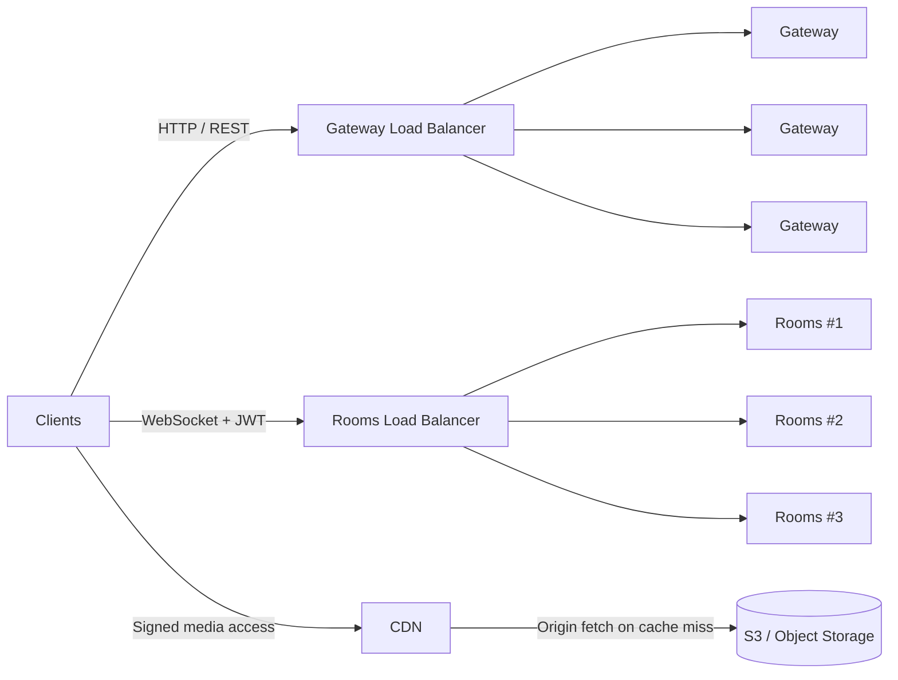
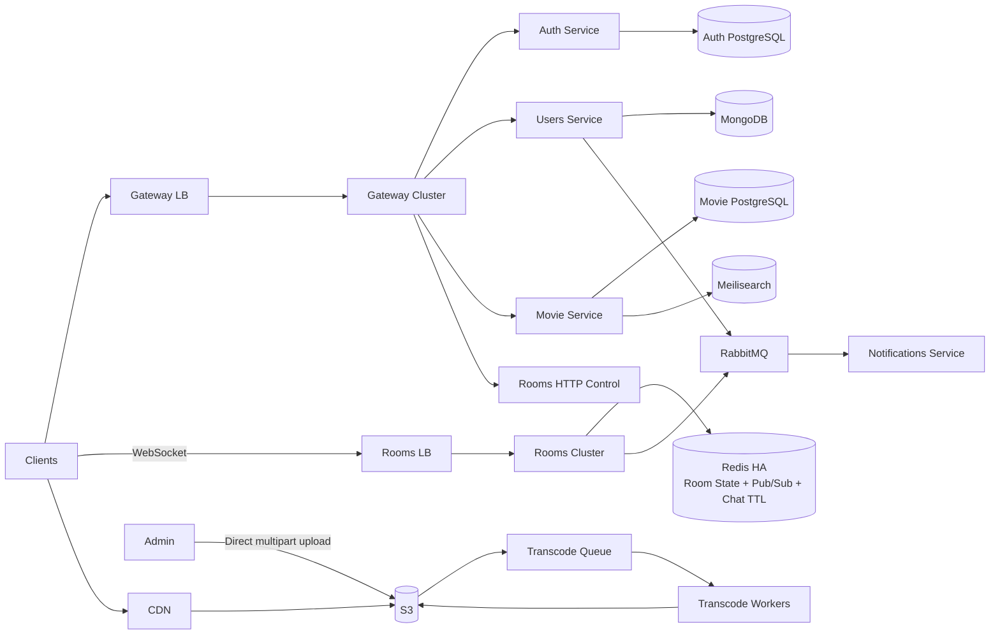

# KinVue — High-Level Architecture v1

## Traffic separation

KinVue has three major external traffic paths.

### API traffic

`Client -> Gateway LB -> Gateway cluster -> services`

Used for:

- auth endpoints;
- user/profile/social APIs;
- movie metadata/search APIs;
- room control APIs such as create/invite.

### Realtime traffic

`Client <-> Rooms LB <-> Rooms cluster`

Used for:

- play;
- pause;
- seek;
- chat;
- reactions;
- presence;
- room realtime events.

The Gateway is intentionally not in the long-lived WebSocket data path.

### Media traffic

`Client <- CDN <- S3`

Video bytes do not pass through Gateway or Movie Service.

---

## Main services

## Key responsibilities

### Gateway

- HTTP edge.
- JWT validation for API requests.
- Routing.
- Rate limiting.
- Request context.
- Potential API composition.
- Stateless and horizontally scalable.

### Auth

- Credentials.
- Identity.
- Access/refresh token lifecycle.
- Registration orchestration.
- Source of truth for identity/credentials.

### Users

- User profiles.
- Preferences.
- Friendships.
- Social/user-related data.
- Source of truth for profile/social data.

### Rooms

- Ephemeral room lifecycle.
- Membership/presence.
- Room permissions.
- Playback synchronization.
- Realtime chat/reactions.
- Reconnect/resync.

### Movie

- Movie metadata.
- Publish lifecycle.
- Search integration.
- Media identifiers/keys.
- Access control for media.
- Source of truth: PostgreSQL.

### Notifications

- Consumes notification-worthy domain events.
- Sends push/in-app notifications according to future channel design.
- Uses at-least-once processing semantics.

### Media pipeline

- Admin uploads directly to S3.
- Queue decouples upload completion from expensive transcoding.
- Workers generate HLS outputs.
- CDN serves processed media.

---

## High-level architectural rule

The HLA is intentionally frozen at v1.

More detail should be added only when:

- a service is being designed in depth;
- a failure scenario proves a missing component;
- a load test proves a scaling problem;
- a new requirement creates a new bounded context.
