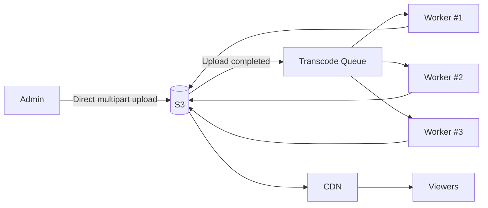

# KinVue — Media Upload, Transcoding, Delivery

## Core principle

Do not proxy huge media files through Gateway or Movie Service.

Large media bytes should flow directly between client/admin and object storage/CDN.

---

## Metadata first

Before a 20 GB upload starts:

1. Admin submits movie metadata.
2. Movie Service writes a small record to PostgreSQL.
3. Movie gets a stable `movieId`.
4. Movie status becomes `UPLOADING`.
5. Movie Service issues direct-upload information/presigned multipart URLs.

Why metadata first:

If a small DB write fails, retrying it is cheap.

Do not upload 20 GB first and then discover that metadata creation failed.

---

## Direct multipart upload

Admin uploads directly to S3/Object Storage.

```text
Admin
  -> request upload authorization
Gateway/Movie
  -> metadata created
  -> presigned multipart URLs
Admin
  => direct multipart upload => S3
```

Multipart/resumable upload prevents restarting an entire 20 GB file after a small network failure.

Only failed/missing parts need retry.

---

## One S3 is enough initially

A single logical bucket/storage can use prefixes:

```text
movies/
  movie-123/
    original/
      original.mp4

    hls/
      master.m3u8
      1080p/
      720p/
      480p/
```

Separate buckets may be introduced later for:

- lifecycle;
- permissions;
- storage class;
- operational isolation.

They are not required in HLA v1.

---

## Transcoding pipeline

After upload completes:

```text
S3
  -> upload-completed event
  -> Transcode Queue
  -> Transcoding Worker(s)
  -> read original from S3
  -> generate HLS renditions
  -> write outputs back to S3
```

Conceptual pipeline:



Workers may use:

- FFmpeg;
- containers;
- a managed transcoding service.

Do not lock the HLA to one exact cloud product yet.

---

## Why queue

The queue provides:

- backpressure;
- load leveling;
- retry boundary;
- independent scaling of expensive compute.

If 50 uploads finish at once, the system does not need to run 50 expensive transcodes at once.

Scale workers based on queue depth and available compute.

---

## Movie processing states

Current conceptual lifecycle:

```text
UPLOADING
  -> PROCESSING
  -> READY
  -> PUBLISHED
```

Failure states may include:

```text
UPLOAD_FAILED
PROCESSING_FAILED
ABANDONED
```

---

## Cleanup

If an upload is abandoned:

```text
UPLOADING for too long
  -> mark ABANDONED
  -> abort multipart upload
  -> remove temporary/orphan media
```

Do not immediately delete almost-complete uploads for recoverable failures.

---

## Playback delivery

Movie Service does not send the video.

Flow:

1. Client requests permission/access through API.
2. Movie Service validates access and returns signed CDN/media access.
3. Client requests media from CDN.
4. CDN returns cached chunks.
5. On cache miss, CDN reads from S3 origin.

```text
Client <- CDN <- S3
```

### Control plane vs data plane

Control plane:

- Gateway;
- Movie Service;
- auth/access;
- metadata;
- signed URLs.

Data plane:

- CDN;
- S3;
- video bytes.

This separation is mandatory at the estimated ~230 Gbps target media load.
