# KinVue — Sequence Diagrams v1

These diagrams are design tools. They should evolve as implementation becomes concrete.

---

## 1. Login

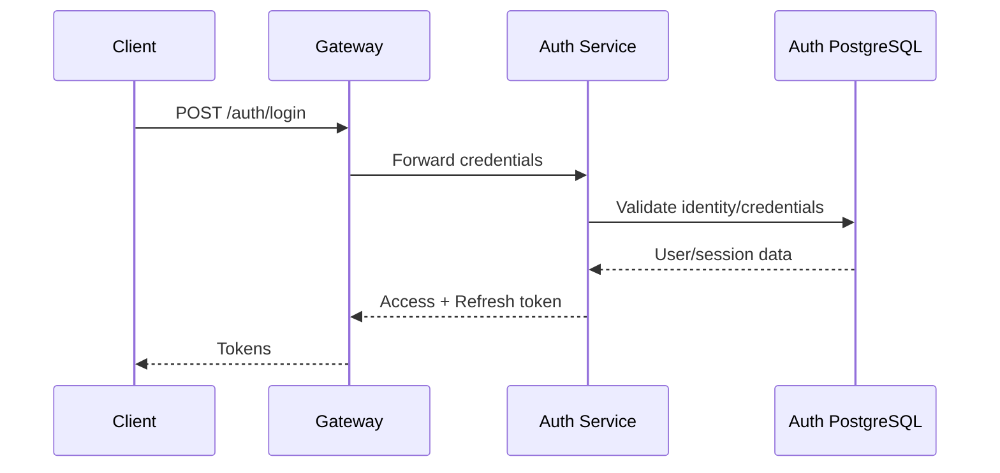

---

## 2. Normal authenticated API request

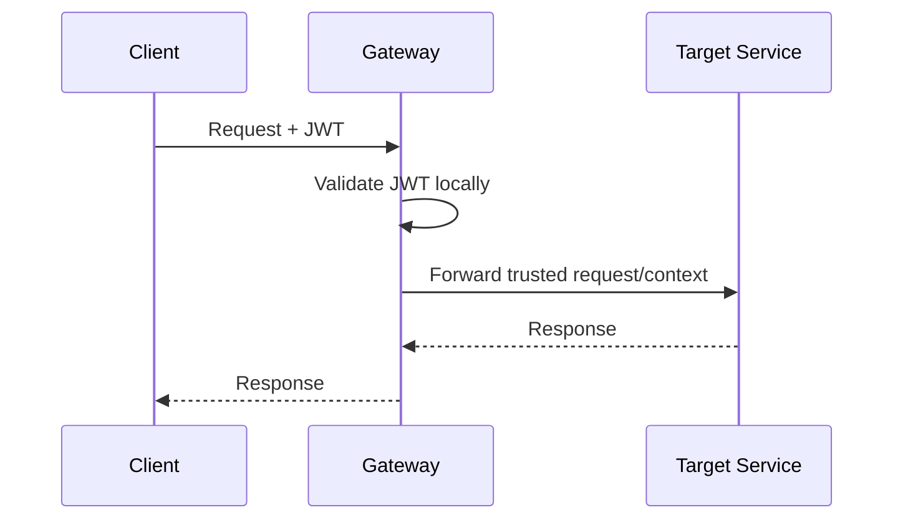

Auth Service is not called.

---

## 3. Refresh token

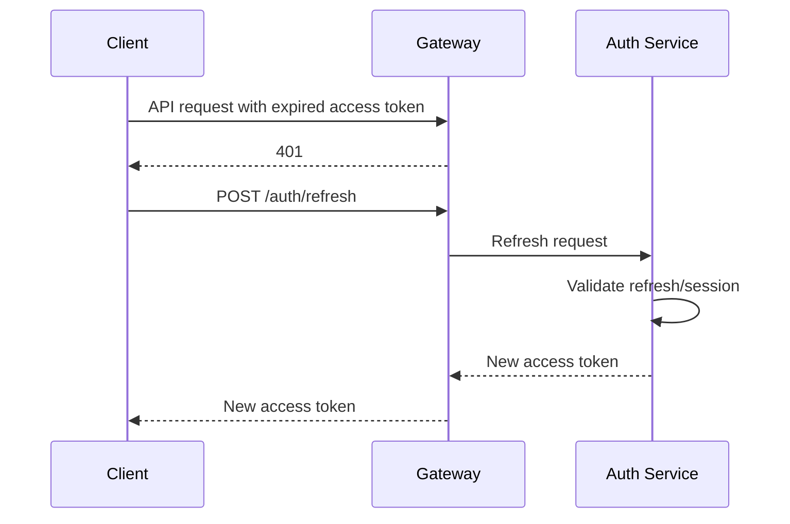

---

## 4. Registration Saga

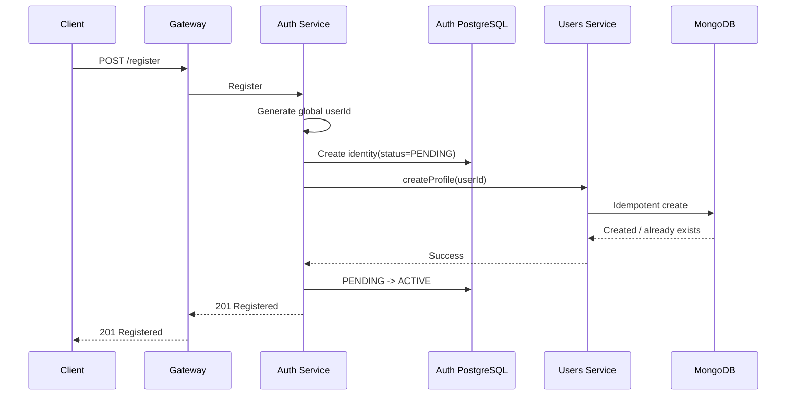

Failure:

- retry `createProfile`;
- compensate pending Auth identity after retry exhaustion.

---

## 5. Create room

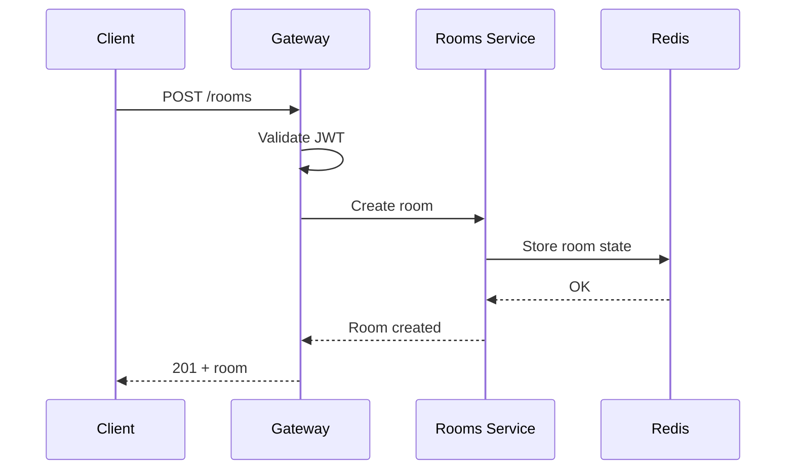

---

## 6. WebSocket join

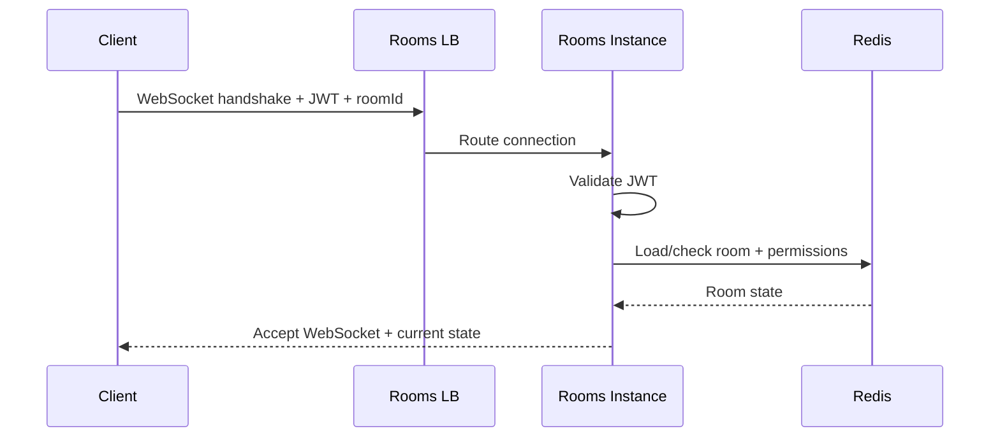

---

## 7. Cross-instance PAUSE

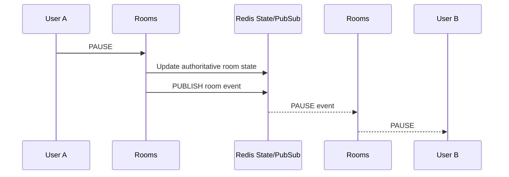

---

## 8. Reconnect and resync

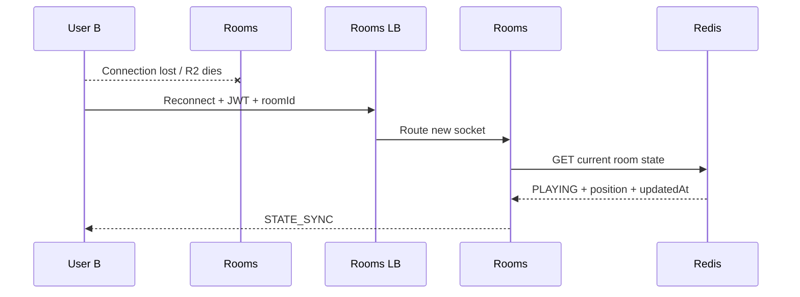

---

## 9. Movie search

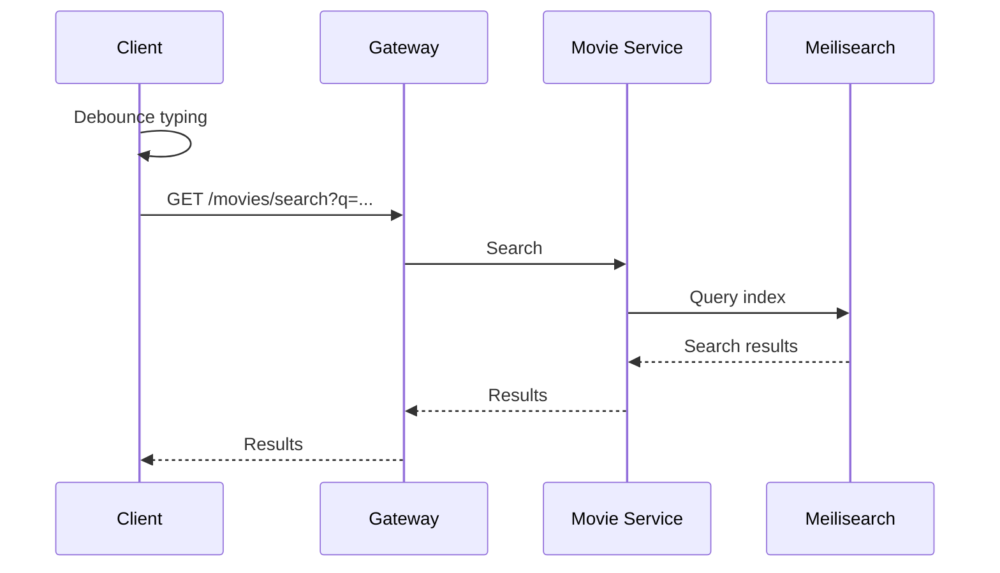

---

## 10. Movie direct upload and processing

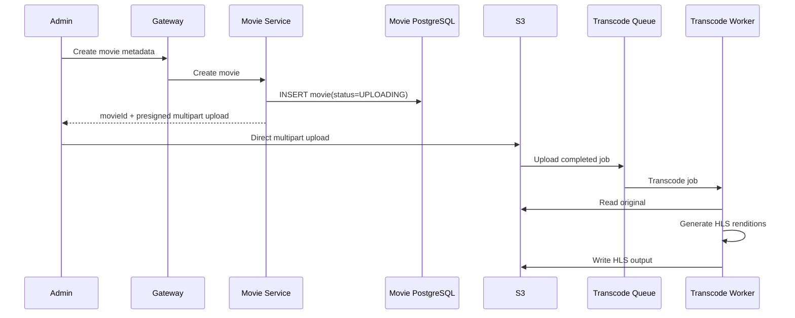

---

## 11. Media playback

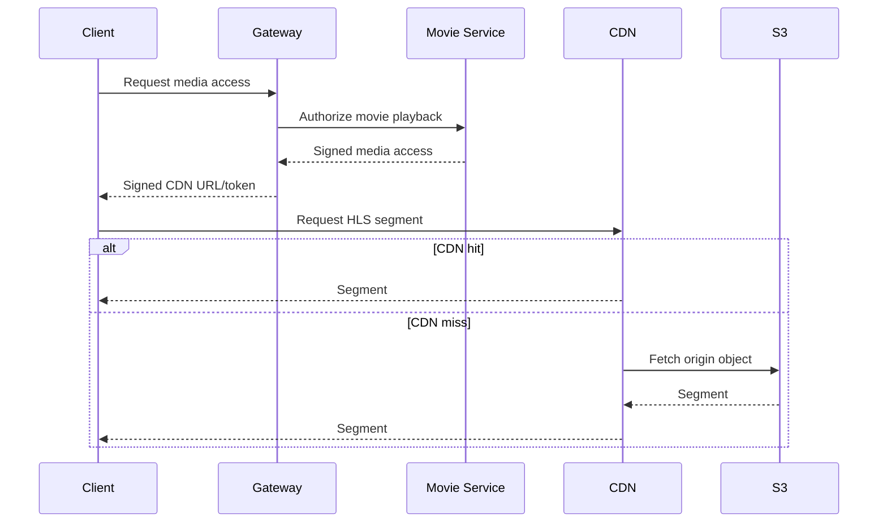

---

## 12. Notification with RabbitMQ

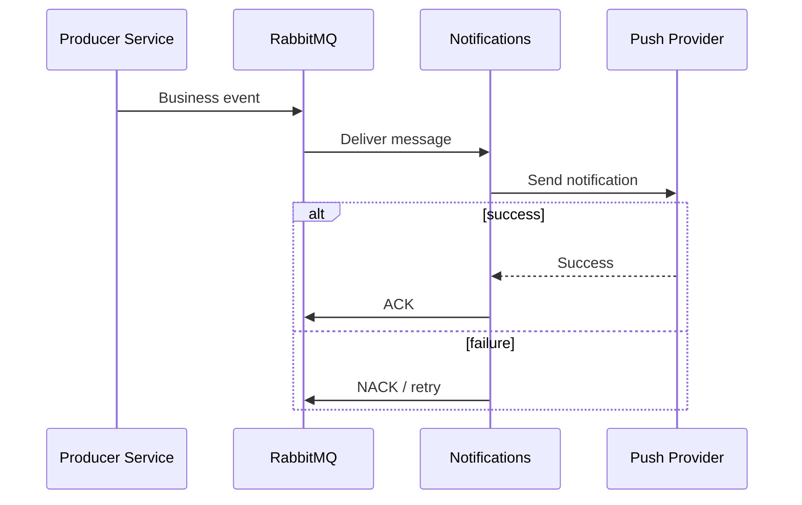

---

## 13. Transactional Outbox

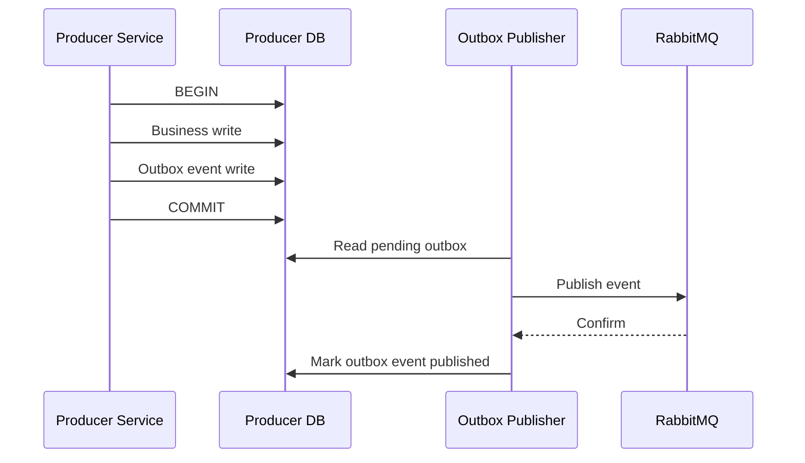

---

## 14. Search reconciliation

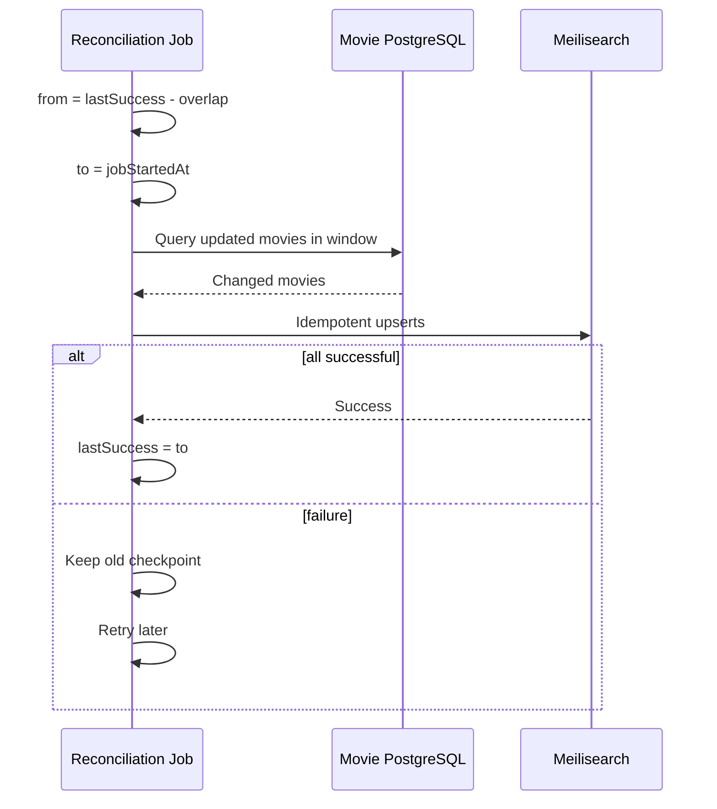
